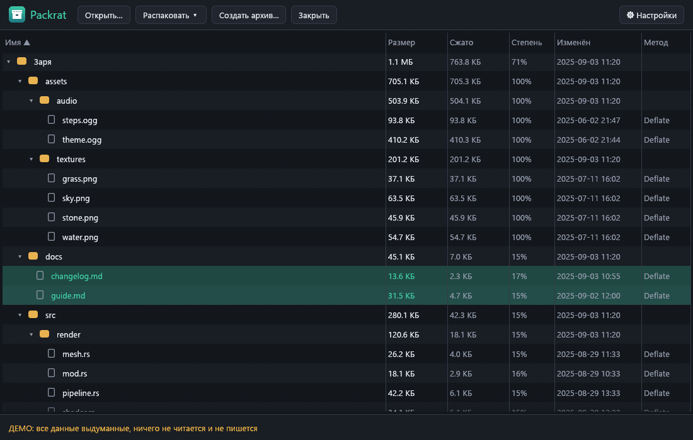

# Packrat

[English](README.en.md) · [Русский](README.md)

Менеджер архивов для Windows (замена 7-Zip + Bandizip + PeaZip): сжатие и распаковка на всех ядрах, «умная»
распаковка без вложенных `Папка\Папка`, безопасная работа с недоверенными архивами и перетаскивание файлов
прямо из окна в Проводник. Написан на Rust, без нативных C-библиотек сжатия.



*Все скриншоты сделаны на выдуманных данных (`Packrat.exe --demo`) — настоящих имён файлов на них нет.*

## Возможности (версия 0.1.0)

- **Форматы.** Чтение и запись: ZIP (store, deflate, zstd) и TAR (в том числе `.tar.gz`, `.tar.zst`, `.tar.xz`,
  `.tar.lz4`). Чтение: 7z (без пароля; LZMA2, BZip2 и PPMd проверены на архивах 7-Zip, остальные методы — средствами библиотеки), одиночные `.gz`, `.bz2`, `.xz`,
  `.zst`, `.lz4`. Создание 7z (LZMA2) тоже есть. RAR не поддерживается: код распаковщика unrar нельзя включать по
  лицензии.
- **Все ядра.** Сжатие: записи ZIP и блоки больших файлов сжимаются параллельно (deflate — независимыми блоками
  как в pigz, zstd и lz4 — независимыми кадрами, 7z — параллельными блоками LZMA2, xz — своими блоками).
  Распаковка независимых записей ZIP идёт параллельно. Число потоков настраивается (`--threads N`, «Настройки»).
  Измеренное ускорение — в [docs/BENCHMARKS.md](docs/BENCHMARKS.md).
- **Умная распаковка.** Один корневой каталог — распаковывается прямо в выбранную папку (без `Папка\Папка`);
  один файл — просто рядом; несколько элементов россыпью — в новую папку с именем архива. Записи вида `./` и
  каталоги, различающиеся только регистром, понимаются правильно.
- **Ничего не перезаписывается без вашего решения.** Перед распаковкой Packrat строит план и показывает, какие
  файлы уже существуют: «пропустить» (по умолчанию), «заменить» или «оставить оба» (`имя (2).txt`).
- **Защита путей.** Записи с `..`, абсолютными путями, буквами дисков, UNC, зарезервированными именами
  (`CON`, `NUL`, `COM1`…), альтернативными потоками NTFS (`имя:поток`, `::$DATA`), хвостовыми точками и пробелами
  не распаковываются: они попадают в список «заблокировано». Символьные ссылки из архивов не создаются, а запись
  через уже существующую ссылку или junction запрещена.
- **Окно.** Дерево содержимого (имя, размер, сжатие, дата, метод), сортировка, выбор нескольких записей,
  распаковка кнопкой и перетаскиванием выбранного в Проводник, перетаскивание архива или файлов в окно (откроет
  архив или предложит создать новый). Русский и английский интерфейс.
- **Командная строка.** `packrat-cli list | extract | create`, `--smart`, `--threads N`.
- **Автообновление.** Раз в сутки один запрос к `api.github.com`; кнопка «Обновление», скачивание, проверка
  SHA-256 по `SHA256SUMS.txt`, замена файла и перезапуск; `Packrat.exe --update` делает то же без окна.
  Отключается в настройках.
- **Диагностика, демо.** Журнал и отчёты о сбоях в `%APPDATA%\Packrat\logs`; `Packrat.exe --demo` показывает
  программу на выдуманных данных.

## Установка

Скачайте `Packrat-Setup.exe` со страницы [Releases](https://github.com/ahsoggg-creator/packrat/releases/latest)
и запустите. Права администратора не нужны — программа ставится в `%LOCALAPPDATA%\Programs\Packrat`, в меню
«Пуск» появляется ярлык, а в «Приложения и возможности» — запись для удаления.

Есть и переносная версия — просто `Packrat.exe`; установить её можно позже из «Настроек». `packrat-cli.exe` —
консольная версия.

### Подпись кода

Исполняемые файлы релизов **не подписаны**: SmartScreen может показать предупреждение «неизвестный издатель»
(«Подробнее» → «Выполнить в любом случае»). Проверить, что файл не повреждён и совпадает с опубликованным, можно
по `SHA256SUMS.txt` из того же релиза. В репозитории есть скрипты для подписи самоподписанным сертификатом
(`scripts\make_cert.ps1`, `scripts\trust_cert.ps1`, `scripts\release.ps1`); закрытый ключ хранится только у автора,
файлы `*.pfx` исключены из git.

## Диагностика и приватность

Packrat ничего никуда не отправляет, кроме проверки обновлений на GitHub (раз в сутки, отключается в
настройках). Телеметрии нет. Локально хранятся:

- `%APPDATA%\Packrat\logs\packrat.log` — события программы (ротация при 512 КБ). Пароли, имена файлов из
  архивов и их содержимое в журнал не пишутся; папка пользователя заменяется на `%USERPROFILE%`;
- `%APPDATA%\Packrat\logs\crashes\crash-<время>.txt` — отчёт о сбое: версия, место паники, стек и хвост журнала.

«Настройки» → «Диагностика» открывают эту папку или копируют диагностический текст в буфер обмена.

## Сборка

Нужен Rust (stable, edition 2024) и MSVC.

```powershell
cargo build --release            # target\release\Packrat.exe и packrat-cli.exe
cargo test --workspace --release
powershell -ExecutionPolicy Bypass -File scripts\release.ps1   # проверки, сборка, dist\ с контрольными суммами
powershell -ExecutionPolicy Bypass -File scripts\bench.ps1     # измерения скорости
```

Структура:

- `crates/core` — форматы, умная распаковка, проверки безопасности, тесты (без интерфейса);
- `crates/app` — GUI на egui, установщик, автообновление, диагностика, демо-режим;
- `crates/cli` — `packrat-cli`;
- `scripts/` — сборка релиза, измерения, сертификат; `docs/` — измерения, заметки релиза, скриншоты.

Тот же exe работает как установщик, если называется `Packrat-Setup.exe` (или запущен с `--install`), и как
деинсталлятор с `--uninstall`. Пересоздать скриншоты (выдуманные данные, ничего реального не читается и не
пишется):

```powershell
Packrat.exe --screenshots docs\screenshots
```

## Ограничения

- RAR не поддерживается (лицензия). В ZIP не читаются методы deflate64, bzip2 и LZMA; пароли и шифрование — в 0.2.0.
- Сжатие zstd — чистый Rust (`ruzstd`), у него один уровень (примерно `zstd -1`): быстро, но слабее, чем у
  официального кодировщика на высоких уровнях.
- Список `.tar.*` строится одним проходом по всему архиву; для больших архивов это не мгновенно.
- 7z создаётся только с LZMA2 и без пароля. Архивы `.tar.lz4` не открываются стандартным 7-Zip (там нет LZ4).
- Перетаскивание файлов из окна в Проводник: объект данных проверен тестом, но сам жест мышью на реальной системе
  автоматически не проверялся.
- Автоопределение кодировок имён, защита от архивных бомб, просмотр файлов внутри архива, меню Проводника и
  ассоциации файлов появятся в следующих версиях (0.2.0 и 0.3.0).

## Лицензия

На ваш выбор:

- Apache License 2.0 ([LICENSE-APACHE](LICENSE-APACHE))
- лицензия MIT ([LICENSE-MIT](LICENSE-MIT))
