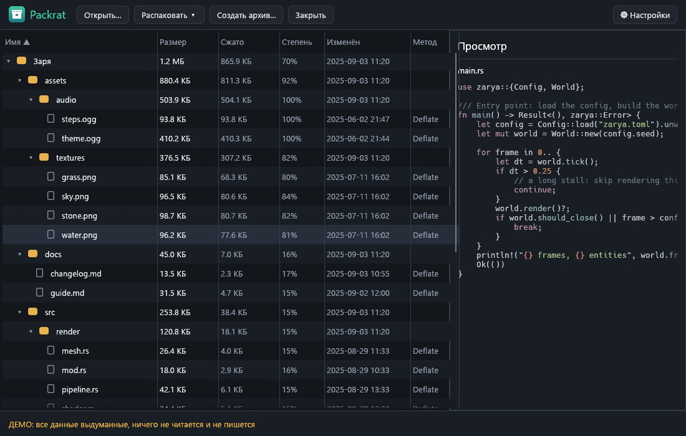
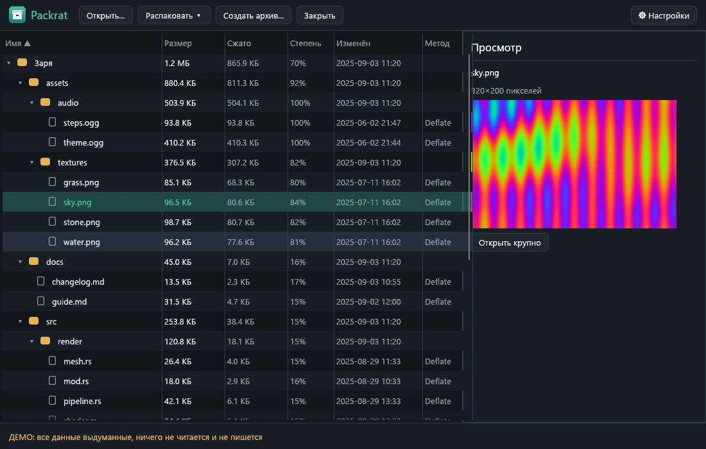
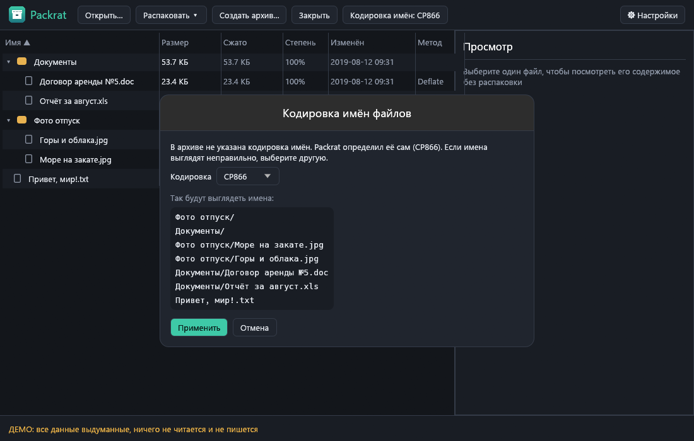
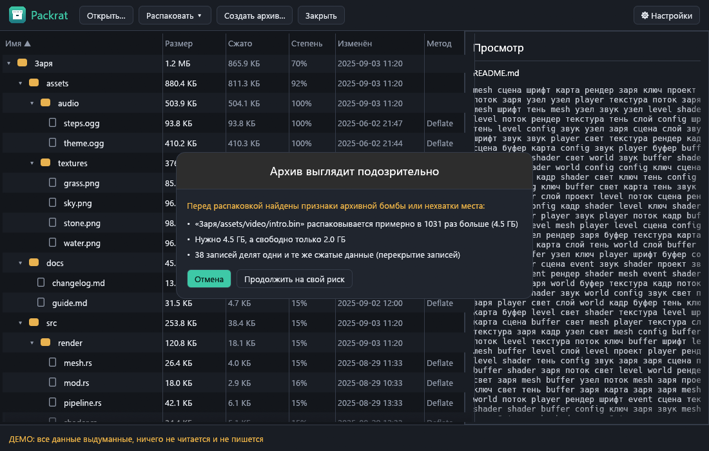

# Packrat

[English](README.en.md) · [Русский](README.md)

Менеджер архивов для Windows (замена 7-Zip + Bandizip + PeaZip): сжатие и распаковка на всех ядрах, «умная»
распаковка без вложенных `Папка\Папка`, защита от опасных архивов, правильные имена в старых ZIP, пароли и просмотр
файлов прямо внутри архива. Написан на Rust; единственный нативный код — распаковщик RAR (unrar, см. [THIRD_PARTY_NOTICES.md](THIRD_PARTY_NOTICES.md)).



*Все скриншоты сделаны на выдуманных данных (`Packrat.exe --demo`) — настоящих имён файлов на них нет.*

## Возможности (версия 0.4.0)

- **Форматы.** Чтение и запись: ZIP (store, deflate, zstd) и TAR (в том числе `.tar.gz`, `.tar.zst`, `.tar.xz`,
  `.tar.lz4`). Чтение: 7z (LZMA2, BZip2 и PPMd проверены на архивах 7-Zip, остальные методы — средствами
  библиотеки), одиночные `.gz`, `.bz2`, `.xz`, `.zst`, `.lz4`. Создание 7z (LZMA2) тоже есть. Только
  чтение: **RAR** (все версии до 5.x, пароли, тома открываются с любой части; через библиотеку unrar), **CAB** (MSZIP, LZX,
  Quantum; один кабинет), **ISO 9660** (Joliet и Rock Ridge), **LZH/LHA**, **AR/DEB**, **CPIO** (в том числе `.cpio.gz`
  и т. п.) и **RPM**. Файлы `.jar`, `.apk`, `.docx`, `.epub`, `.cbz` и подобные — это ZIP и открываются так же.
- **Все ядра.** Записи ZIP и блоки больших файлов сжимаются параллельно (deflate — независимыми блоками как в pigz,
  zstd и lz4 — независимыми кадрами, 7z — параллельными блоками LZMA2, xz — своими блоками). Распаковка независимых
  записей ZIP идёт параллельно. Число потоков настраивается (`--threads N`, «Настройки»). Измеренное ускорение —
  в [docs/BENCHMARKS.md](docs/BENCHMARKS.md).
- **Умная распаковка.** Один корневой каталог — прямо в выбранную папку (без `Папка\Папка`); один файл — рядом;
  несколько элементов россыпью — в новую папку с именем архива. Записи `./` и каталоги, различающиеся только
  регистром, понимаются правильно.
- **Ничего не перезаписывается без вашего решения.** Перед распаковкой строится план: существующие файлы
  показываются заранее, по умолчанию пропускаются; можно заменить или оставить оба (`имя (2).txt`).
- **Имена в старых ZIP.** Если в архиве нет флага UTF-8 и поля Unicode Path, Packrat определяет кодировку имён
  (CP866, Windows-1251, CP437, Shift-JIS, GBK, Big5, EUC-KR) по статистике и показывает, какая выбрана. Кнопка
  «Кодировка имён» открывает окно с примером того, как будут выглядеть имена в любой кодировке; выбор применяется
  сразу. В CLI — `--encoding cp866`.
- **Защита от опасных архивов.** Записи с `..`, абсолютными путями, буквами дисков, UNC, зарезервированными именами
  (`CON`, `NUL`, `COM1`…), альтернативными потоками NTFS (`имя:поток`, `::$DATA`), хвостовыми точками и пробелами
  блокируются; символьные ссылки не создаются, запись через существующую ссылку или junction запрещена. Перед
  распаковкой Packrat проверяет признаки **архивной бомбы** и предупреждает кнопками «Отмена» / «Продолжить на свой
  риск»: слишком большой коэффициент сжатия (запись ≥ 250× при размере от 64 МБ, архив ≥ 150× от 1 ГБ),
  суммарный размер больше 50 ГБ, больше миллиона записей, нехватка свободного места (с запасом 256 МБ),
  **перекрывающиеся записи ZIP** (общие сжатые данные), вложенные архивы глубже трёх уровней. Если размер заранее
  неизвестен (одиночный `.gz` и подобные), лимиты действуют прямо во время распаковки. Ни одна запись не может
  выдать больше байт, чем объявлена в заголовке.
- **Пароли.** ZIP: AES-256 (WinZip AE-2) — чтение и создание; старый ZipCrypto — только чтение, с предупреждением о
  слабости. 7z: AES-256, в том числе шифрование имён файлов (чтение и создание). Пароль нигде не сохраняется, не
  попадает в журнал и в командную строку (в CLI — `--ask-password`, `--password-file` или `PACKRAT_PASSWORD`).
  Совместимость проверена с 7-Zip 26.01 в обе стороны.
- **Проводник.** Меню «Packrat» для архивов (открыть, распаковать здесь, в папку, проверить) и для любых файлов (добавить в `.zip`, `.7z`, `.tar.zst`, своё имя). При выделении нескольких файлов окно открывается один раз со всеми. Ассоциации `.zip`, `.7z`, `.tar` и др. включаются и откатываются в «Настройках»; права администратора не нужны.
- **Проверка и восстановление.** «Проверить целостность» (CRC и SHA-256), `packrat-cli test`. Повреждённый или оборванный ZIP читается по локальным заголовкам (`extract --repair`), частично распакованные файлы сохраняются. При «доступ запрещён» предлагается повторить от имени администратора.
- **Просмотр без распаковки.** Выберите файл — справа появится его содержимое: картинки (PNG, JPEG, GIF, BMP, WebP)
  с миниатюрой и крупным просмотром, текст и код с подсветкой синтаксиса, шестнадцатеричный вид для остального. Для
  ZIP читается только нужная запись (тест считает прочитанные байты); для TAR и «солидных» 7z архив читается до
  нужного файла с пометкой «может быть медленно» и лимитом на объём, который можно пропустить. Размеры
  просмотра ограничены (текст — 256 КБ, картинки — 16 МБ, hex — 4 КБ).
- **Окно.** Дерево содержимого (имя, размер, сжатие, дата, метод), сортировка, множественный выбор, распаковка
  кнопкой или перетаскиванием в Проводник, перетаскивание архива или файлов в окно. Русский и английский интерфейс.
- **Командная строка.** `packrat-cli list | extract | create`, `--smart`, `--threads N`, `--encoding`,
  `--accept-risks`, пароли.
- **Автообновление.** Раз в сутки один запрос к `api.github.com`; кнопка «Обновление», проверка SHA-256 по
  `SHA256SUMS.txt`, замена файла и перезапуск; `Packrat.exe --update` — то же без окна. Отключается в настройках.
- **Диагностика, демо.** Журнал и отчёты о сбоях в `%APPDATA%\Packrat\logs`; `Packrat.exe --demo` показывает
  программу на выдуманных данных.







## Установка

Скачайте `Packrat-Setup.exe` со страницы [Releases](https://github.com/ahsoggg-creator/packrat/releases/latest)
и запустите. Права администратора не нужны — программа ставится в `%LOCALAPPDATA%\Programs\Packrat`, в меню
«Пуск» появляется ярлык, а в «Приложения и возможности» — запись для удаления.

Есть и переносная версия — просто `Packrat.exe`; установить её можно позже из «Настроек». `packrat-cli.exe` —
консольная версия.

### Подпись кода

Исполняемые файлы релизов **не подписаны**: SmartScreen может показать предупреждение «неизвестный издатель»
(«Подробнее» → «Выполнить в любом случае»). Проверить, что файл не повреждён и совпадает с опубликованным, можно
по `SHA256SUMS.txt` из того же релиза. В репозитории есть скрипты для подписи самоподписанным сертификатом
(`scripts\make_cert.ps1`, `scripts\trust_cert.ps1`, `scripts\release.ps1`); закрытый ключ хранится только у автора,
файлы `*.pfx` исключены из git.

## Диагностика и приватность

Packrat ничего никуда не отправляет, кроме проверки обновлений на GitHub (раз в сутки, отключается в
настройках). Телеметрии нет. Локально хранятся:

- `%APPDATA%\Packrat\logs\packrat.log` — события программы (ротация при 512 КБ). Пароли, имена файлов из
  архивов и их содержимое в журнал не пишутся; папка пользователя заменяется на `%USERPROFILE%`;
- `%APPDATA%\Packrat\logs\crashes\crash-<время>.txt` — отчёт о сбое: версия, место паники, стек и хвост журнала.

«Настройки» → «Диагностика» открывают эту папку или копируют диагностический текст в буфер обмена.

## Сборка

Нужен Rust (stable, edition 2024) и MSVC.

```powershell
cargo build --release            # target\release\Packrat.exe и packrat-cli.exe
cargo test --workspace --release
powershell -ExecutionPolicy Bypass -File scripts\release.ps1   # проверки, сборка, dist\ с контрольными суммами
powershell -ExecutionPolicy Bypass -File scripts\bench.ps1     # измерения скорости
```

Структура:

- `crates/core` — форматы, умная распаковка, проверки безопасности, кодировки, пароли, просмотр, тесты (без интерфейса);
- `crates/app` — GUI на egui, установщик, автообновление, диагностика, демо-режим;
- `crates/cli` — `packrat-cli`;
- `scripts/` — сборка релиза, измерения, сертификат; `docs/` — измерения, заметки релиза, скриншоты.

Тот же exe работает как установщик, если называется `Packrat-Setup.exe` (или запущен с `--install`), и как
деинсталлятор с `--uninstall`. Пересоздать скриншоты (выдуманные данные, ничего реального не читается и не
пишется):

```powershell
Packrat.exe --screenshots docs\screenshots
```

## Ограничения

- RAR только читается (создать нельзя — лицензия unrar не позволяет); RAR внутри другого архива сначала нужно распаковать. CAB из нескольких файлов, ISO с файлами больше 4 ГиБ, UDF-образы, легаси-форматы `.Z`, `.lzma` не поддерживаются. В ZIP не читаются методы deflate64, bzip2 и LZMA.
- Автоопределение кодировки — статистическое и проверено на сгенерированных именах (русские в CP866 и CP1251,
  японские, китайские, корейские); на коротких или смешанных именах оно может ошибиться — тогда выберите кодировку
  вручную. Только ZIP: имена в TAR и 7z читаются как UTF-8.
- Пороги защиты от бомб эвристические: честный архив с огромной степенью сжатия вызовет предупреждение (его можно
  принять), а бомба, подогнанная под пороги, пройдёт без него — но ни один путь не выйдет за папку назначения, и
  запись не выдаст больше байт, чем объявлено.
- ZIP AES: проверен AES-256 (так пишут 7-Zip и Packrat); чтение AES-128/192 реализовано, но не проверялось.
  Пароль к ZipCrypto берётся как UTF-8; проверено только с ASCII. TAR зашифровать нельзя.
- Сжатие zstd — чистый Rust (`ruzstd`), у него один уровень (примерно `zstd -1`).
- Список `.tar.*` строится одним проходом по всему архиву; для больших архивов это не мгновенно. 7z создаётся только
  с LZMA2. Архивы `.tar.lz4` не открываются стандартным 7-Zip (там нет LZ4).
- Просмотр: картинки больше 16 МБ и файлы дальше 256 МБ от начала потокового архива не показываются (предлагается
  распаковать). Подсветка использует набор языков syntect по умолчанию.
- Перетаскивание файлов из окна в Проводник: объект данных проверен тестом, но сам жест мышью на реальной системе
  автоматически не проверялся.
- Меню Проводника и ассоциации проверены в изолированной ветке реестра, но не в живом Проводнике. Восстановление повреждённого архива работает только для ZIP.

## Лицензия

На ваш выбор:

- Apache License 2.0 ([LICENSE-APACHE](LICENSE-APACHE))
- лицензия MIT ([LICENSE-MIT](LICENSE-MIT))
